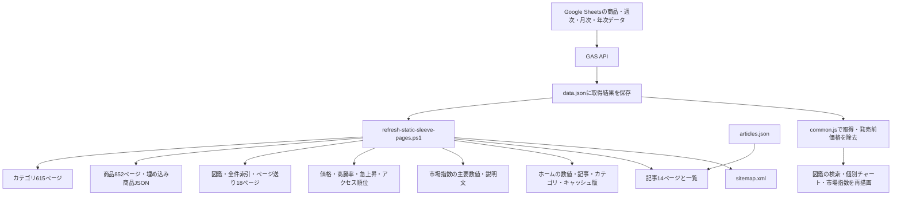

# ポケスリ相場ナビ：サイト構造・AdSense再申請前監査

調査日：2026年10月12日（日本時間）  
対象：pokesuri-navi.com／現在のリポジトリ  
実施内容：全1,535HTMLのローカル検査、852商品の価格・履歴検査、公開21URLのHTTP取得、公開3ページのEdgeヘッドレスDOM検査。サイト本体の修正は実施していない。

## 判断

**価格を採用・補正する処理の違い、価格の観測時点が見えないこと、情報が少ないページとサンプルの公開範囲を優先して改善すべき。**

提示された調査の方向性は有用だが、PJCS2026の325.5円差と「市場指数の主要数値が空」という例は現在の配信内容では再現しない。取得キャッシュや以前の配信状態を現在の不具合と混同しないことが必要。一方、別の価格差と市場指数の読み込み前後の不一致は現在も再現する。

これは審査ログに基づく不承認原因の断定ではない。以下の「確定不具合」は実装・表示の問題が確定しているという意味で、AdSense不承認との因果関係まで確定したという意味ではない。

## 現状の構造

| 種類 | HTML数 | サイトマップ掲載 | 備考 |
|---|---:|---:|---|
| 個別商品ルート | 853 | 852 | 現役852商品＋移動済みルート1件 |
| カテゴリ結果・旧カテゴリ | 616 | 303 | 現役615カテゴリ＋移動済み1件。現役のうち1商品だけの312カテゴリはnoindex |
| ページ送り一覧 | 18 | 18 | 1ページ50件、総852商品 |
| 記事 | 14 | 14 | articles.jsonには19件。残り5件は独立した特集HTMLへのリンク |
| 入口・機能・補助 | 25 | 19 | ホーム、図鑑、ランキング、市場指数、特集、問い合わせ、方針、テンプレート等 |
| 管理画面 | 6 | 0 | 6件ともnoindex、広告読込コードなし |
| サンプル | 3 | 0 | 固定の実験用価格配列、同一タイトル、noindexなし |
| **合計** | **1,535** | **1,206** | 公開21URL中20件が200、ads.txtのみ404 |

公開HTML・data.json・robots.txt・sitemap.xmlの取得結果は、確認した20件すべてでローカルと改行を正規化した内容が一致した。全1,535ページをネットワーク取得したわけではない。

通常のブラウザ取得は[common.js](../../assets/common.js:2150)でローカルdata.jsonを先に読み、失敗時などにGASへ進む。「常に最新GASを直接取得するサイト」ではなく、**取得済みJSONと生成済みHTMLを公開し、一部をブラウザで再計算する構造**。

主な再生成入口は[refresh-static-sleeve-pages.ps1](../../scripts/refresh-static-sleeve-pages.ps1)。このスクリプト自体はGAS取得を行わない。最新版JSONの保存と全再生成を一組の更新手順にする必要がある。

## 提示された問題の再検証

| 指摘 | 現在の確認結果 | 評価 |
|---|---|---|
| PJCS2026：図鑑1,436.5円／個別1,111円 | 最新JSONは9/28週1,436.5円・2件。個別は静的HTMLもブラウザ実行後も1,437円 | 古い観測値の差は現在再現しない。小数丸めの差は残る |
| 市場指数が確認中・集計中 | 直接取得したHTMLに9/28、平均2,524円、対象764、更新184、説明文が存在 | 主要数値の静的化は済んでいる。グラフ本体は初期HTMLで空 |
| 発売時価格0円 | firstPrice=0の商品は101件。個別・索引は0円を許容する実装 | 表示は確認済み。ただし各0円が不明・無料・セット収録のどれかは元資料で確認が必要 |
| 発売年別記事に年別集計表なし | 対象記事にtableは0、中央値・集計件数の比較表もなし | 独自データを分析に生かす改善余地がある |
| 35,000円の取引数が不明 | 「・・・じゃない」ポケモンたちの9/28週は1件、9/14週7,999円も1件 | データには件数がある。現在価格の隣に件数がなく、週グラフへ切り替えないと見えにくい |

外部取得サービスは市場指数・PJCSの古い内容を返したが、キャッシュ回避パラメータ付きの直接HTTP取得と隔離したブラウザでは現在の値を確認できた。これはGoogleの審査環境の再現ではない。

## 確定不具合

### 1. 市場指数の静的HTMLとブラウザ計算が異なる

対象：[市場指数](https://pokesuri-navi.com/index-market.html)

| 項目 | 初期HTML／生JSONで計算 | ブラウザ／補正後JSONで計算 |
|---|---:|---:|
| 9/21週の対象数 | 763 | 759 |
| 9/21週の平均価格 | 2,502.2588円 | 2,508.2378円 |
| 9/28週の平均価格 | 2,524.3567円 | 2,524.3567円 |
| 前回比表示 | +22円、+0.9% | +16円、+0.6% |
| コメント | 上昇 | ほぼ横ばい |

原因は入力補正。[静的生成](../../scripts/generate-market-index-static-content.ps1:60)は生のdata.jsonを利用し、ブラウザは[発売前データ除去](../../assets/common.js:318)を通してから計算する。基準となる9/21週の構成が変わるため、9/28週の平均が同じでも比較値が変わる。

**対応：** 同じ補正済みデータと共通の計算関数から、静的値・チャート・コメントを生成する。現在の検証は静的生成内部の一致を確認しているが、ブラウザ入力との一致までは検査していない。

### 2. 個別9商品で初期価格とブラウザ表示が変わる

一覧：[static-runtime-price-disagreements.csv](static-runtime-price-disagreements.csv)

例：[ぼうしをかぶったピカチュウ カロス](https://pokesuri-navi.com/sleeve/4521329227610/)は初期HTML4,100円、ブラウザ実行後3,250円。実ブラウザでも再現した。

data.jsonには2026/2の月次価格4,100円と2026年の年次価格4,100円があるが、[全期間系列](../../detail.html:5151)は2026年以降の月次を外し、年次価格も全期間系列に入れない。その結果、2024/12の月次3,250円へ戻る。残る8商品は初期価格が存在するのにブラウザ後は「-」になる。

**対応：** 現在価格の選択と「グラフにどの粒度を描くか」を分離する。週次・月次・年次の採用優先順と補完時の表示を統一する。

### 3. 観測日を書き込むDOMが852ページすべてにない

[setPriceKpiFromSeries](../../detail.html:5327)はweeklyCountに最終観測日を書き込むが、テンプレートにその要素がない。代替の空オブジェクトへ代入しているため例外も出ず、画面に現れない。PJCSの実ブラウザDOMでも観測日欄はない。

履歴表やグラフでは日付が分かるが、上部の「現在価格」だけでは何週の観測値か分からない。週グラフの取引件数表示は修正済みで、その検証は通る。しかし週グラフを選ぶ前の価格欄には件数がない。

**対応：** 価格欄に「最終観測週／採用件数」を表示する。サイト全体の更新日と商品固有の最終観測週を別に扱う。

### 4. 内容枚数と1枚あたり価格の除数が27商品で違う

現在のgetSleeveSheetCountは32枚カテゴリだけを特別扱いし、それ以外を64枚とする。商品のカテゴリには62枚販売16件、60枚6件、10枚3件、65枚1件、30枚1件がある。

**対応：** 内容枚数を商品データに持たせ、単価計算に使う。価格未取得の商品は今は「-」だが、取得後にも同じ計算ミスが起きる。対象URLは[findings.csv](findings.csv)のUNIT_PRICE_SHEET_COUNTで抽出できる。

## 審査リスクと商品ごとの情報量

以下は調査用の分類で、Googleの合否基準ではない。週次点数は取引件数ではなく、正の価格がある期間の数。

| 分類 | 商品数 | 判断・対応 |
|---|---:|---|
| 週次履歴4点以上 | 607 | データによる独自価値がある。観測日・採用件数・集計方法を補強 |
| 週次履歴1〜3点 | 163 | 「参考値」「観測が少ない」を分かりやすく表示。自動判断を強く言い切らない |
| 週次なし・補完データを表示 | 1 | 週次と補完価格の違いを表示。現在は価格不一致もある |
| データあり・現行チャート採用履歴なし | 24 | 年次のみ、月次カットオフ、発売前データ等を個別点検 |
| 価格データなし | 57 | 商品資料としての価値を個別確認。情報補強と広告対象の見直しを優先 |
| **合計** | **852** | 全商品の記録は[products.csv](products.csv) |

全852商品に画像URLと発売日がある。ただし画像URLがあることと、外部画像が常に取得できることは別。全852画像のHTTP応答や画像内容は今回検査していない。

最終週次観測が90日以上前の商品は131件。正の週次価格を持つ770商品では最新行に正の取引件数があり、件数自体が欠けているわけではない。ただし週次件数が全て妥当であることは原取引なしには保証できない。

前回観測比2倍以上かつ最新週2件以下の候補は17件。[outlier-candidates.csv](outlier-candidates.csv)に記録した。誤価格と決めつけず、元取引、商品状態、セット商品、送料等を確認する対象。「・・・じゃない」ポケモンたちは1件で約337.6%上昇している。

GASの[週次読込処理](../../scripts/pokesuri-api.gs:770)はid・week・price・countをシートから取り出す。ここからは元取引単位の採用・除外条件や外れ値確認の記録を確認できない。人による選別がないとは断定できないが、その作業の証拠と基準を公開画面へ伝える必要がある。

「AI相場診断」は[buildAiMarketDiagnosis](../../detail.html:3322)の閾値判定と文章組み立てで実装されている。価格中央値、価格レンジ、前回比などに根拠はあるが、外部生成AIへの推論依頼や元取引の真偽判定はこの処理にない。「データに基づく相場分析」等の名称や計算方法の説明を検討するとよい。

### 公開範囲と広告

広告読込コードは1,498HTMLにあり、そのうち314ページはnoindex。手動のins広告枠は0件だったが、Auto ads設定や実際の広告配信はAdSenseアカウントを確認していないため判断できない。

[sample-1](https://pokesuri-navi.com/sleeves/sample-1.html)・sample-2・sample-3は固定の価格配列で、同じ商品タイトル、noindexなし、広告読込コード付き。sample-1は公開200を確認済み。

[detail.html](https://pokesuri-navi.com/detail.html)も公開200で、idがなければエラーになるテンプレート。noindexなし、広告読込コード付き。サンプルとテンプレートは公開・検索・広告の対象を見直す優先度が高い。

Googleはコンテンツのない画面や有用性が低い画面への広告を制限し、手続き完了・エラー画面等も例示している。今回確認したのはコードの存在であり、違反広告が実際に配信されたことまで確認したわけではない。[Google Publisher Policies](https://support.google.com/publisherpolicies/answer/11112688?hl=ja)

noindexは検索への登録を制御するもの。広告の配信除外とは別である。また、Googleは申し込みURLだけでなくサイト全体を審査対象と説明しているため、サイトマップから外すだけで対応済みとはいえない。[検索のnoindex仕様](https://developers.google.com/search/docs/crawling-indexing/block-indexing?hl=ja)、[AdSense不承認について](https://support.google.com/adsense/answer/81904?hl=ja)

## 問題が確認されなかった構造

- robots.txtは公開200、全体のクロールを許可し、サイトマップのURLを指定している。
- サイトマップ1,206URLは重複なし、対象ファイルの欠落なし、初期HTMLでnoindexのページを掲載していない。
- 852商品の埋め込みJSONはmasterと全件一致する。個別商品・現役カテゴリのcanonicalは存在する。
- 解析できた静的リンクの内部リンク切れ0、参照するローカルアセットの欠落0、JSON-LDのJSON構文エラー0。JavaScript生成リンク、外部URL、schemaの意味的適合まではこの数値に含めない。
- 現役615カテゴリは312件が1商品のnoindex、303件が複数商品でサイトマップ掲載。意図した分類と一致する。
- 図鑑本体のnoindexはクエリ付きURLに対してJavaScriptで付く。クエリなしの/sleeves/が一律noindexという構造ではない。
- 運営方針ページには問い合わせ、個人情報・広告・アクセス解析、非公式サイト・権利者、参考価格の免責について記載がある。ただし精密な相場採用条件の説明とは別。

canonicalがない15ページには管理画面、エラー、テンプレート、問い合わせ、方針、サンプル等が含まれる。すべて同じ重大度で扱わず、公開対象と目的に応じて判断する。

ads.txtは公開404でローカルにもない。Googleは必須ではなく推奨と説明しているため、不承認の原因とは断定しない。[Googleのads.txtガイド](https://support.google.com/adsense/answer/12171612?hl=ja)

## 独自分析記事への提案

既存の「古いデッキシールドは本当に高い？」には発売年別統計を追加できる。作成可能な集計を[release-year-statistics.csv](release-year-statistics.csv)に保存した。

以下は**商品の最新の正の週次価格**による例。基準データの最新週は2026/9/28だが、商品ごとに観測週は異なる。掲載総数・価格ありの商品数を分け、取引単位の価格分布ではないことを明記する必要がある。

| 発売年 | 掲載数 | 価格あり | 中央値 | 3,000円以上の割合（価格ありを分母） |
|---|---:|---:|---:|---:|
| 2017 | 58 | 48 | 4,090円 | 64.6% |
| 2020 | 82 | 78 | 2,211円 | 32.1% |
| 2025 | 73 | 73 | 1,099円 | 2.7% |

商品年代と希少性、取引頻度、相場未取得商品、古い観測値の影響を分けて解説する。古いほど高いという因果関係をこの表だけから断定しない。キャラクター別、価格変動の分布、観測件数別でも同様の独自分析が可能。

## 改善順と確認条件

1. **価格の採用・補正・丸めを共通化する。** 市場指数の+22／+16、個別9件の静的／実行時差、42件の小数表示差を解消する。統一基準は「最も新しい有効観測を採用し、補完元と観測日を明示」等として仕様化する。
2. **価格の隣に観測週・採用件数を出す。** 少数取引・長期間未観測は参考値であることを伝える。0円の101件は資料確認後、不明・無料・単品定価なしなどを分ける。
3. **公開と広告の対象を見直す。** サンプル3件、空のテンプレート、価格なし57件、未採用履歴24件、単商品カテゴリを順に評価する。テンプレートであることだけを理由に852商品を一括noindexにしない。
4. **主要グラフや集計表の静的表示を補う。** 市場指数の主要数値は既に存在するので、その成果を維持して空のグラフ部分を補強する。GoogleはJavaScriptを処理するが、処理・レンダリングには制約があるため、重要な情報の初期HTML出力は有用。[GoogleのJavaScript SEO資料](https://developers.google.com/search/docs/crawling-indexing/javascript/javascript-seo-basics?hl=ja)
5. **データ集計方法と独自記事を整える。** 状態、期間、平均・中央値、送料、セット商品の除外、人の確認、外れ値対応、少数標本時の扱いを資料のある範囲で説明する。既存記事に統計を追加する。

改善後は、静的HTML・ブラウザDOM・図鑑・ランキング・個別の同商品を照合する検査を追加する。Search ConsoleのURL検査と実際のAdSense不承認メール・管理画面の理由も確認する。今回の資料だけで合格を保証したり、再申請時期を断定したりはできない。

## 保存した資料と検証

| ファイル | 内容 |
|---|---|
| [findings.csv](findings.csv) | URL別の確定不具合・審査リスク・改善推奨、優先度、根拠、対応。1URLに複数行あり |
| [pages.csv](pages.csv) | 全1,535HTMLの種類、canonical、noindex、サイトマップ、広告コード等 |
| [products.csv](products.csv) | 全852商品の週次・月次・年次情報、観測日、件数、画像URL、情報量分類 |
| [static-runtime-price-disagreements.csv](static-runtime-price-disagreements.csv) | 初期HTMLと実行時価格が変わる9件 |
| [price-disagreements.csv](price-disagreements.csv) | 小数丸め42件＋補完元が異なる1件。古い価格データの混在43件という意味ではない |
| [zero-retail.csv](zero-retail.csv) | 発売時価格0の101件 |
| [outlier-candidates.csv](outlier-candidates.csv) | 個別確認対象17件。誤価格と断定していない |
| [categories.csv](categories.csv) | 615カテゴリの件数・noindex・サイトマップ |
| [release-year-statistics.csv](release-year-statistics.csv) | 記事に利用できる発売年別統計 |
| [public-snapshot.json](public-snapshot.json) | 公開21URLのHTTP・内容一致・主要値の記録 |
| [browser-snapshot.json](browser-snapshot.json) | 公開PJCS・カロス・市場指数の読み込み後DOMの主要値 |
| [summary.json](summary.json) | 集計結果・生JSONと補正後JSONの市場計算結果 |

再実行：`node scripts/audit-site-structure.mjs --date 2026-10-12`。公開取得：`node scripts/audit-public-snapshot.mjs`。ローカル監査はネットワークを使わず、成果物だけを生成する。

既存のホーム静的内容、価格・急上昇・高騰率ランキング、アクセスランキング、週グラフ件数の4検証スクリプトはすべて通過した。それでも今回の不一致が残るのは、それらが各処理内部の一致を中心に検査しており、入力補正や静的／実行時の差の全体を検査していないため。

AdSense審査ログ、Search Console、Auto adsの除外設定、すべての原取引・画像の権利資料にはアクセスしていない。画像URLの存在、JSON-LDの構文、価格差の再現と、審査の最終判断・権利の確認は区別する。

Googleの公式資料は独自性、関連性、使いやすさを求めている。「商品ページを何文字にすれば合格」「記事を何本にすれば合格」という一律の条件に置き換えず、このサイトが持つ相場履歴と編集・確認の価値を伝える改善を優先する。[AdSenseに適したページについて](https://support.google.com/adsense/answer/7299563?hl=ja)
